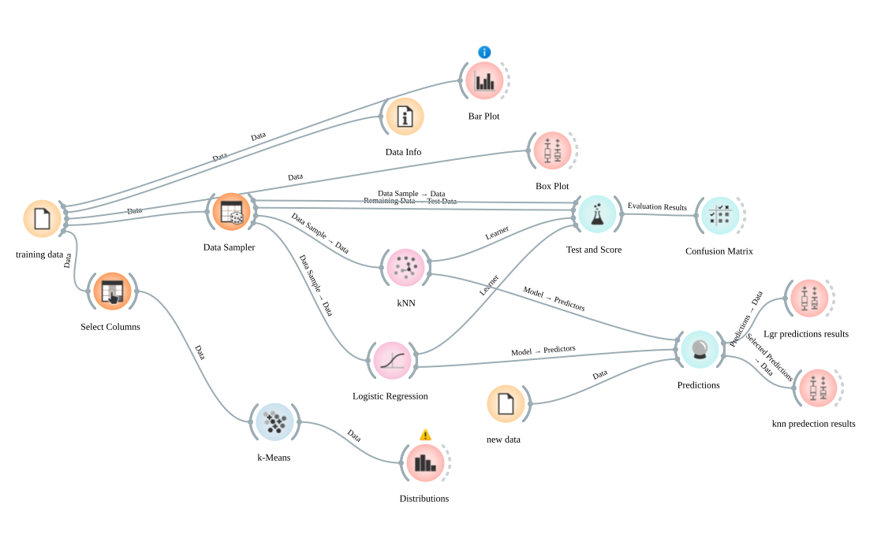
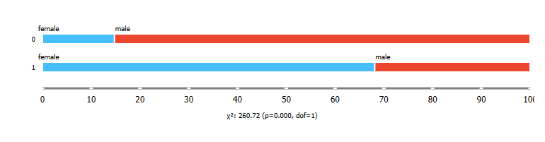
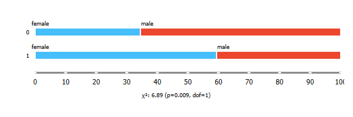

# Titanic Survival Prediction

Predicting which Titanic passengers survived from age, sex, class and family features, done twice: visually in **Orange** and in **Python / scikit-learn**, then written up in a **Typst** report.

<p align="center">
  <br>
  <sub>The Orange workflow: data → preprocessing → KNN / logistic regression → confusion matrices and predictions.</sub>
</p>

## What was done

- Exploration and cleaning of the Kaggle dataset (`titanic_Data/`): missing ages, cabin, embarkation port; encoding of categorical features
- **K-Nearest Neighbours** and **logistic regression**, each implemented in Orange (`codes/titanic prediction.ows`) and in a notebook (`codes/titatanic survival predection.ipynb`)
- Comparison on a held-out split — in the notebook, KNN reaches about **77 %** and logistic regression about **83 %** accuracy
- Report written in Typst (`report.typ` → `report.pdf`)

<p align="center">
  
  
</p>

## Layout

| Path | Contents |
|---|---|
| `codes/` | Orange workflow (`.ows`) and the Jupyter notebook |
| `titanic_Data/` | `train.csv`, `test.csv`, `gender_submission.csv` |
| `orange_plots/`, `Images/` | Plots and confusion matrices used in the report |
| `report.typ`, `Class.typ`, `Themes/` | Typst source, class and code-highlighting themes |
| `report.pdf` | Compiled report |

## Running

```bash
pip install pandas scikit-learn matplotlib seaborn jupyter
jupyter notebook "codes/titatanic survival predection.ipynb"
```

Open `codes/titanic prediction.ows` in [Orange](https://orangedatamining.com/) for the visual version. Build the report with `typst compile report.typ`.
